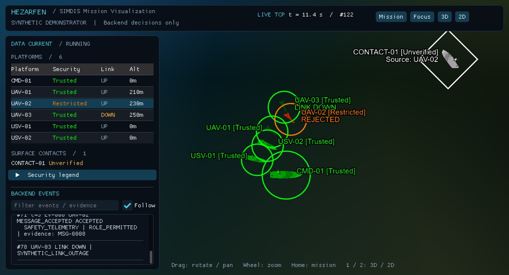
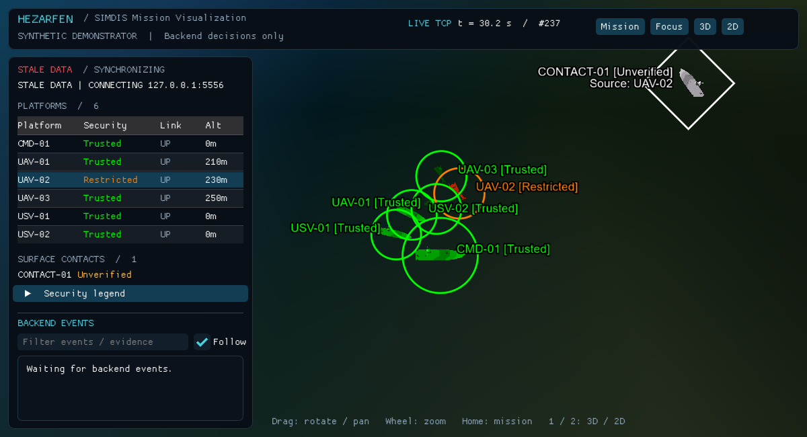
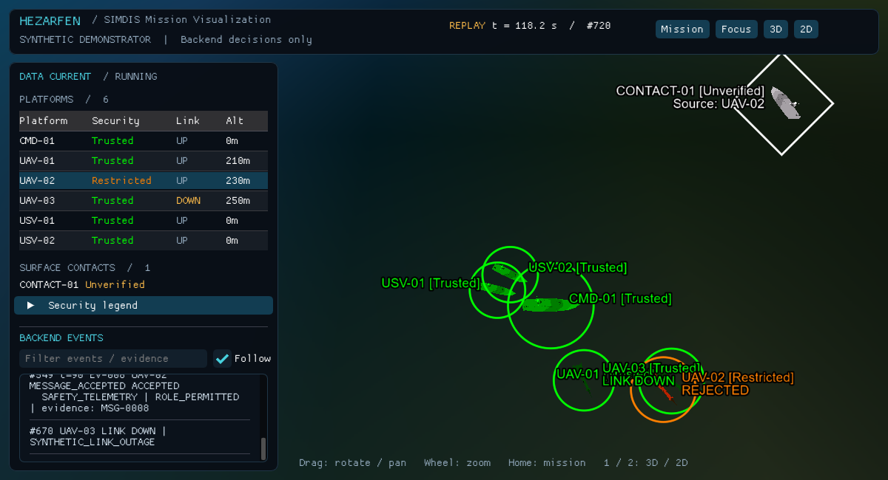

# HEZARFEN viewer validation — 26 October 2026

This is a software-only synthetic demonstration. The captures below are real OpenGL framebuffers from the compiled native SIMDIS application, not mockups. Live scenario actions were deliberately compressed through the unchanged backend HTTP controls; they are not the 150-second automatic presentation schedule.

## Environment and official example

| Item | Observed |
|---|---|
| OS | Windows 10 x64, 10.0.19045 |
| Compiler | MSVC 19.51.36248.0, Visual Studio 18 2026, `D:/VisualStudio` |
| CMake | 4.3.4 |
| SIMDIS SDK | 1.25.0, ABI 25, `D:/SIMDIS_SDK` |
| Source/examples | `D:/Projects/simdissdk/Examples` |
| Data/models | `D:/Projects/SIMDIS_SDK-Data` |
| OpenSceneGraph | 3.6.5 |
| Actual renderer | NVIDIA GeForce 940MX/PCIe/SSE2 |
| Actual GL context | 3.3.0 NVIDIA 582.66 |
| Config | Debug x64; the SDK installation contains only Debug libraries |

Before application networking was added, the `OfficialBasicViewer` target compiled and linked the unmodified official `Examples/BasicViewer/BasicViewer.cpp`. The resulting executable was launched successfully with SDK runtime/data paths and remained responsive. This established that the real SDK and graphics dependencies could run on this machine.

APIs were checked against the installed headers and source: `Viewer`, `View`, `Scenario`, `HudManager`, `PlatformSymbology`, `DataTypeUpdates`, and `CoordinateConverter`. Of particular importance, platform TSPI positions are **ECEF meters**, orientations are earth-centric radians, and `View::lookAt()` takes **latitude then longitude**.

## Passed checks

| Check | Evidence/result |
|---|---|
| Native application build | `cmake --build viewer/build-verified --config Debug --parallel 4` succeeds |
| C++ protocol/state/transport tests | CTest passes; 1,907 checks across all 913 actual backend recording messages |
| Existing backend suite | All 22 tests pass; backend source unchanged |
| JSON parsing | UTF-8 and escapes accepted; malformed JSON, duplicate keys, unsupported version, negative sequence, wrong field types, missing platform fields, invalid coordinates/altitudes/states and payload >1 MiB rejected |
| Coordinate math | Known equator ECEF coordinate plus round-trip latitude/longitude/altitude/heading for all six platforms |
| Native TCP transport | Byte-fragmented length header, seven-byte payload fragments, UTF-8, oversized frame rejection, reconnect, bounded shutdown |
| Backend live integration | Actual TCP SNAPSHOT/DELTA/SECURITY_EVENT/CONTACT_EVENT/LINK_EVENT/HEARTBEAT rendered by C++ application |
| Six real SDK platforms | All `sdk_active=true`; `sdk_position_m` matches converted ECEF values within 1 cm |
| Security state | Backend Watch/Restricted displayed; rejected command stays visible despite later accepted safety telemetry |
| Contact | CONTACT-01 remains Unverified with UAV-02 provenance |
| Logical outage | UAV-03 LINK DOWN displayed while trust remains Trusted and other paths continue; explicit UP restores link label |
| Actual observer disconnect | Backend process terminated while viewer stayed open; screenshot shows STALE DATA |
| Fresh reconnect snapshot | Backend restarted; at least two snapshots consumed; contacts/restrictions reset from authoritative snapshot; retained platforms are not duplicated |
| Offline native replay | Live mode tested first, then all 913 recording messages replayed inside SIMDIS; final `t_sec=150`, `applied=913`, REPLAY COMPLETE |
| Thread ownership | Worker parses/queues; viewer frame handler applies scene/datastore/HUD updates; single-threaded render traversal |
| Ownership | Only `viewer/` committed on `feat/simdis-viewer`; backend and recordings unchanged |

Run the reproducible commands in [README.md](README.md). `tests/integration_check.py` verifies return codes, active SDK nodes, positions, backend states, reconnect and complete replay. Screenshots were also visually inspected: sea/coastal background, ship/aircraft models, six labels, orange restriction marker, contact, link-down label, state legend and ordered event panel are visible.

## Genuine running-application captures

Each PNG is a single capture at the requested wall-clock offset. The matching JSON report is written when that application run exits; it can therefore describe a later state than the screenshot. For example, `live.png` captures LINK DOWN while `live.json` records the subsequent explicit LINK UP. Likewise, `reconnect.png` shows stale data before the fresh snapshot reflected in `reconnect.json`. Console transcripts preserve receipt order and the actual GL renderer.

## Encountered errors and resolutions

- The unfinished CMake file used nonexistent `simVis::simVis`-style targets and added dependencies too late. It now discovers the installed SDK dependencies and links the exported `VSI::` targets.
- The existing build cache uses Visual Studio 18 2026. Trying Visual Studio 17 2022 in that cache produced a generator mismatch. A separate `viewer/build-verified` directory uses the installed generator and compiler; the old build tree was preserved.
- `simVis::Viewer` has neither `getViewManager()` nor `realize()` in this installed version. Calls now go through its main `View` and the underlying viewer using actual header signatures.
- Framebuffer diagnostics required explicit OpenGL linkage. `OpenGL::GL` resolves `glGetString` and `glGetIntegerv`.
- The inherited code put geodetic radians directly into ECEF fields, discarded message time/provenance, and used a partial string-search JSON parser. These were replaced and validated against the full backend capture.
- The first visual capture exposed reversed camera latitude/longitude; the SDK header and implementation confirmed the correct order, and all delivered screenshots were regenerated after correction.
- A second window resize could crop the HUD on this display. The application now creates a 1200-by-650 window once; the final full-frame captures were verified without clipping.
- Desktop UI automation access timed out. Validation used the application's actual framebuffer capture plus SDK node readback and native process execution instead.

## Dear ImGui update

The old text HUD has been replaced by a native Dear ImGui 1.92.4 mission monitor in the same SIMDIS application. It includes independent security/link columns, selectable platform rows, platform tooltips, camera controls, expandable legend, and a scrollable event list with text filtering and optional follow. Follow scrolls only when a new backend event arrives, rather than on every telemetry sequence. Backend protocol and source are unchanged.

The integration check now requires `ui=Dear ImGui` and `ui_frames>0` in each application report. Live, disconnect/reconnect and all-913-message replay checks passed with the ImGui renderer. PNGs were regenerated from the actual framebuffer after the ImGui draw callback; the map and SDK entities remain native SIMDIS. The ImGui OpenGL3 backend is compiled directly from the installed SDK dependency sources; its source directory is configurable in CMake.

The ImGui display dimensions come from the actual graphics window traits. This avoids using the smaller temporary GL viewport left by other rendering passes, which initially misplaced/cropped panels. Header layout and the full sidebar were visually verified at 1200 by 650 pixels. Texture binding and pixel-unpack state are preserved around ImGui dynamic font updates. Dashboard ASCII glyphs are baked at both UI sizes before the first texture upload to keep rapid replay from reallocating the UI font atlas during rendering. The original native TCP/state/coordinate test results remain applicable; UI integration adds no security rules.

Desktop automation access to the application was not approved, so mouse/keyboard gestures were not exercised automatically. Rendering, native scene state, streaming, stale status, reconnect and replay were verified through application execution and framebuffer/readback evidence.

## Remaining limits

There are no unresolved compile, link, live TCP, reconnect or offline replay failures in the tested configuration. SDK sometimes prints `GraphicsWindowWin32::grabFocus() - Failed grabbing the focus` for background test launches; the window still creates, renders, captures and exits successfully.

The bundled global Earth imagery is coarse at mission scale; no high-resolution Marmara terrain package is installed. SDK dependencies/data remain external, and no standalone redistributable package is claimed. Mouse gestures, keyboard shortcuts and ImGui interactions are implemented but were not automated through the desktop tool. Quarantined/Revoked colors are supported by the observer; the current backend does not generate those states. Display positions use the last received sample without interpolation. The viewer does not perform real authentication, authorization, threat detection, corroboration or experimental validation.
